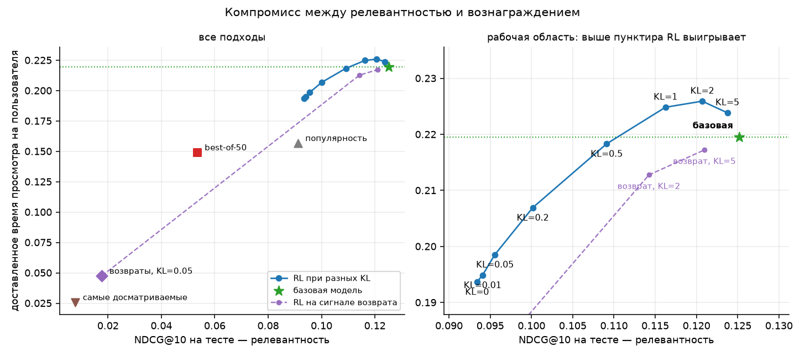
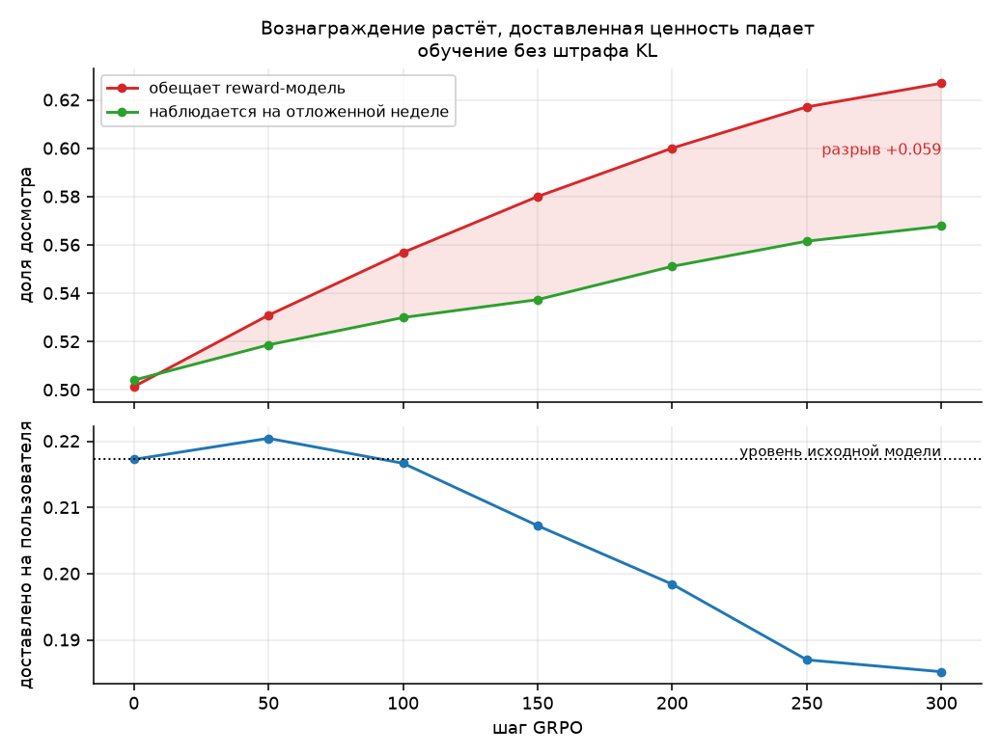
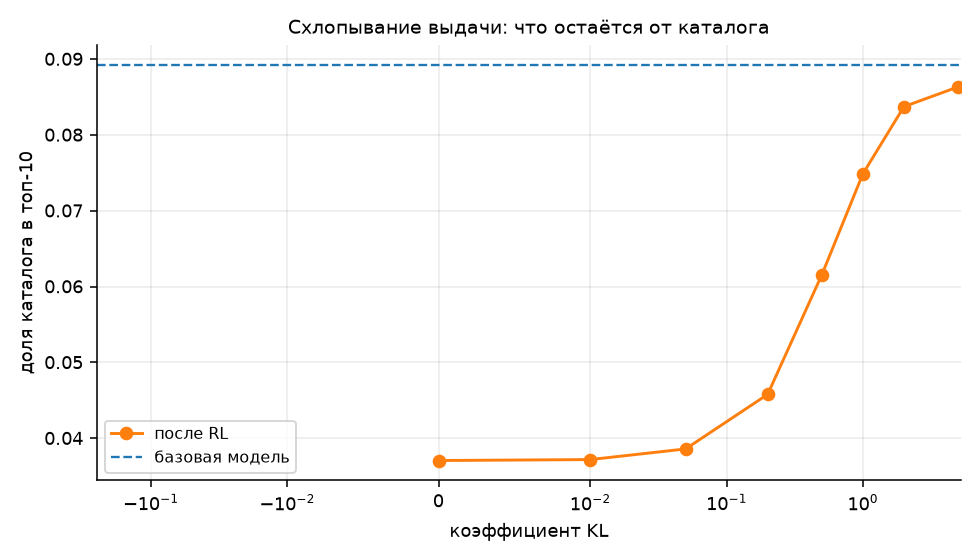
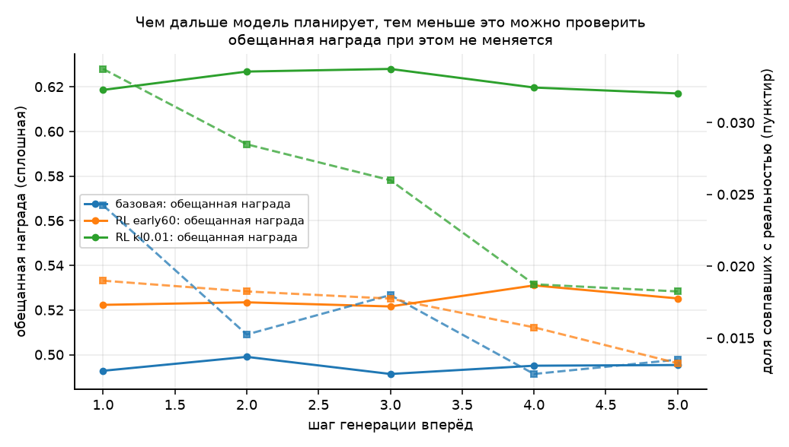

# RL-дообучение последовательной рекомендательной модели

Отчёт по заданию T-Lab 2026, RecSys, задание 2. Датасет — KION от МТС.


## Содержание

- [Коротко: что сделано и что получилось](#коротко-что-сделано-и-что-получилось)
- [Постановка](#постановка)
- [Данные и разбиение](#данные-и-разбиение)
- [Почему здесь нет утечек](#почему-здесь-нет-утечек)
- [Базовая модель](#базовая-модель)
- [Модели вознаграждения](#модели-вознаграждения)
- [Метод RL](#метод-rl)
- [Что на самом деле выучила модель вознаграждения](#что-на-самом-деле-выучила-модель-вознаграждения)
- [Второй сигнал: возвращается ли пользователь](#второй-сигнал-возвращается-ли-пользователь)
- [Что сделало RL](#что-сделало-rl)
  - [Вознаграждение растёт, ценность падает](#вознаграждение-растёт-ценность-падает)
  - [Подпись взлома reward-модели](#подпись-взлома-reward-модели)
  - [Почему схлопывание было предсказуемо](#почему-схлопывание-было-предсказуемо)
- [Рисунки](#рисунки)
- [Компромисс между релевантностью и вознаграждением](#компромисс-между-релевантностью-и-вознаграждением)
  - [Это не шум](#это-не-шум)
  - [Стандартные для RLHF значения KL здесь не работают](#стандартные-для-rlhf-значения-kl-здесь-не-работают)
  - [Жадная оптимизация вознаграждения без ограничения](#жадная-оптимизация-вознаграждения-без-ограничения)
  - [Что меняется в поведении модели](#что-меняется-в-поведении-модели)
- [Многошаговая генерация](#многошаговая-генерация)
- [Долгосрочные цели](#долгосрочные-цели)
  - [Что можно проверить офлайн, а что нельзя](#что-можно-проверить-офлайн-а-что-нельзя)
- [Ограничения](#ограничения)
- [Воспроизведение](#воспроизведение)
- [Структура репозитория](#структура-репозитория)

## Коротко: что сделано и что получилось

Базовая модель — GPT-2 (2.8 млн параметров) на next item prediction по KION,
токены это идентификаторы контента. Две модели вознаграждения: доля досмотра и
возврат пользователя в течение недели. Дообучение — GRPO со штрафом KL к
замороженной исходной политике. Разбиение по времени, тестовые две недели
читаются один раз, шесть автотестов на утечки.

**Главный результат: максимизировать вознаграждение легко, и именно это
опасно.** Наивная оптимизация поднимает предсказанное вознаграждение на 25% и
при этом снижает реально доставленное время просмотра на 12%. Полезный режим
существует, но он узкий, и находится там, где штраф KL на два порядка сильнее
принятого в RLHF.

Итог на тесте, 20 000 пользователей:

| подход | NDCG@10 | обещанная награда | **доставлено на пользователя** |
|---|---|---|---|
| **RL, KL = 2** | 0.1207 | 0.555 | **0.2259** (+2.9%) |
| RL, KL = 5 | 0.1237 | 0.531 | 0.2239 |
| **базовая GPT-2** | **0.1252** | 0.503 | **0.2195** |
| RL, KL = 0 | 0.0934 | 0.630 | 0.1937 (−12%) |
| популярность | 0.0911 | 0.507 | 0.1568 |
| best-of-50 по вознаграждению | 0.0534 | 0.670 | 0.1491 (−32%) |
| RL на сигнале возврата | 0.0177 | 0.633 | 0.0475 (−78%) |
| десять самых досматриваемых | 0.0077 | **0.779** | 0.0258 (−88%) |

Таблица читается снизу вверх: **чем выше обещанное вознаграждение, тем ниже
доставленная ценность.** Оптимум модели вознаграждения — это список-константа
из десяти позиций, одинаковый для всех.

Шесть вещей, которые стоит прочитать, даже если дальше читать не хочется.

**1. Наивная метрика врёт, и я поймал это на себе.** Среднее вознаграждение по
попавшим рекомендациям росло всё обучение — с 0.504 до 0.568, выглядело как
успех. Но его знаменатель сокращается вместе с числом попаданий, с 2586 до
1957: политика, рекомендующая мало, но «безопасно», выглядит лучше, чем она
есть. С фиксированным знаменателем — доставлено на пользователя — та же кривая
растёт до 50-го шага, а потом падает на 15%.

**2. Взлом reward-модели измерен, а не заявлен.** Разрыв между обещанным и
наблюдаемым вознаграждением вырос с −0.003 в начале до +0.059 к 300-му шагу,
монотонно. Видно это только потому, что наблюдаемое считается на отложенных
данных; по тому числу, которое оптимизирует RL, кривая выглядит ровным успехом
до самого конца.

**3. Схлопывание было предсказано до эксперимента.** Диагностика показала, что
70% дисперсии модели вознаграждения объясняется айтемом и лишь 30% —
персонализацией. Отсюда следовало, что политика поедет к глобально
досматриваемому контенту. Покрытие каталога упало с 8.9% до 3.7%.

**4. Стандартные для RLHF коэффициенты KL здесь занижены на два порядка.**
Весь диапазон 0.01–0.1 лежит в области схлопывания. Рабочая область — от 1 до 5.
Причина структурная: у языковой модели уйти далеко мешает сама грамматика, у
рекомендателя любой из 15 706 айтемов — допустимое продолжение.

**5. Тривиальное переранжирование оказалось хуже RL, а не лучше.** Я ожидал
обратного. Best-of-50 по модели вознаграждения поднимает обещанную награду выше
любого прогона RL и при этом роняет NDCG на 57%. Ценность RL здесь не в
оптимизации вознаграждения — она в том, что штраф KL даёт регулируемый способ
забрать часть выигрыша, не уходя далеко.

**6. Сигнал, который хорошо предсказывается, не обязан хорошо
оптимизироваться.** Сигнал «вернулся за неделю» независим от доли досмотра
(корреляция −0.002) и персонализируется в десять раз лучше — казалось бы,
идеальная цель для RL. Первый прогон против него обрушил NDCG в семь раз, и я
записал это как катастрофу. При перепроверке выяснилось, что штраф KL был взят
из зоны схлопывания; при рабочем KL обвала нет (NDCG 0.1287 против базовых
0.1331), но нет и пользы — доставленная ценность ниже исходной при любом
штрафе. Причина в том, что возврат определяется активностью самого
пользователя, а не рекомендацией, и градиент политики от такого сигнала не
получает направления. Это проверяемо до запуска обучения: у награды-досмотра
70% разброса приходилось на айтем, и политике было за что тянуть; у возврата
основной источник разброса — пользователь.

## Постановка

Задание предлагает три шага: обучить GPT-2 на next item prediction, построить
модель вознаграждения, дообучить рекомендатель с помощью RL — и разобраться,
что при этом происходит с поведением модели.

Главная сложность не в том, чтобы поднять предсказанное вознаграждение. Поднять
его легко. Сложность в том, чтобы отличить настоящее улучшение от эксплуатации
ошибок модели вознаграждения, и чтобы это отличие было **измерено**, а не
заявлено. Вся конструкция этой работы построена вокруг такого измерения.

## Данные и разбиение

KION: 5 476 251 просмотр, 15 706 единиц контента, 962 179 пользователей, период
с 13 марта по 22 августа 2021 года. Токены — идентификаторы айтемов, плюс два
служебных (`PAD`, `BOS`), итого словарь 15 708.

Разбиение по времени, одно и то же для всех этапов:

| часть | период | назначение |
|---|---|---|
| обучение | до 2 августа | базовая модель, обе reward-модели, промпты для RL |
| валидация | 2–9 августа | ранняя остановка, выбор коэффициента KL, наблюдение за RL |
| тест | 9–22 августа | единственный финальный замер |

Пользователей с историей не меньше пяти событий до 2 августа — 240 275; из них
58 813 имеют целевые события на валидационной неделе и 77 009 на тестовых.

**Ограничение, которое стоит назвать сразу.** Таймстемпы в KION дневные, и
30.2% пользовательских дней содержат больше одного события (в среднем 2.84).
То есть примерно треть порядка внутри «последовательности» принципиально
неизвестна. Внутри дня события упорядочены по идентификатору айтема — это
воспроизводимо, но произвольно. Для последовательной модели это существенный
шум, и его надо держать в уме при чтении любых цифр ниже.

**Второе свойство датасета, меняющее постановку.** В таблице взаимодействий
ровно одна строка на пару (пользователь, айтем): повторных просмотров нет
вообще. Поэтому классический способ взлома reward-модели — «рекомендовать уже
знакомое, оно точно понравится» — здесь невозможен, и уже просмотренное
исключается из ранжирования как гарантированно неверное. Ломаться модель будет
иначе, и как именно — отдельный вопрос этой работы.

## Почему здесь нет утечек

В последовательных моделях утечка прячется тише, чем в признаковых пайплайнах:
целевой айтем может попасть в собственный контекст, reward-модель может увидеть
то самое событие, отклик на которое предсказывает, а промпты для RL могут
оказаться взяты из недель, отведённых под оценку. Все три случая проверяются
напрямую на тех тензорах, которые получает обучение
(`tests/test_no_leakage.py`, шесть тестов):

1. **Обучающие окна заканчиваются на срезе.** Ни одно окно базовой модели не
   содержит событий после 2 августа.
2. **Reward-модель не видит своей цели.** В истории примера нет того айтема,
   отклик на который она предсказывает.
3. **Валидация и тест берутся из своих окон.** Примеры для каждой части
   приходят только из её периода.
4. **Контекст оценки не содержит целевых айтемов.**
5. **Отравление будущим.** Добавление синтетических событий в конец каждой
   последовательности обязано оставить обучающие окна и контексты оценки
   побитово теми же.
6. **Уже просмотренное исключается из ранжирования.** Иначе модель получала бы
   баллы за повторение того, что повториться не может.

## Базовая модель

GPT-2 (`GPT2LMHeadModel` из transformers), 4 слоя, 4 головы, скрытая
размерность 128, контекст 32 айтема, 2.8 млн параметров. Обучение — обычный
причинный языковой лосс, батчи собираются по длине истории, потому что медиана
длины 9, и паддинг до 32 стоил бы втрое дороже.

## Модели вознаграждения

**Доля досмотра.** Предсказывает `watched_pct / 100` для пары (история,
кандидат). Трансформерный ствол читает историю, последнее скрытое состояние
соединяется с эмбеддингом кандидата, и их поэлементное произведение подаётся в
голову — ответ зависит от совпадения истории и кандидата, а не от каждого по
отдельности.

Рядом измеряются два baseline'а, и это не формальность. Если модель не обходит
«среднее по айтему», значит она выучила не отклик пользователя, а
популярность айтема под другим именем, и весь дальнейший RL оптимизировал бы не
то, что заявлено.

**Возврат в сервис.** Вторая модель предсказывает другой сигнал: было ли у
пользователя хоть одно событие в течение семи дней после этого. Это не
удержание в строгом смысле, а его офлайн-прокси, но единственный долгосрочный
вопрос, на который дневные таймстемпы KION отвечают честно.

## Метод RL

GRPO. Для каждого контекста политика сэмплирует группу из восьми кандидатов,
reward-модель их оценивает, преимуществом каждого служит его награда минус
среднее по собственной группе, нормированное на разброс внутри группы. Критик
не нужен — на ноутбуке это решающее соображение.

Штраф KL считается к замороженной стартовой политике и **по всему
распределению айтемов**, а не только по сэмплированным: вся тревога как раз в
том, что масса тихо перетекает к десятку популярных позиций, и по сэмплам это
видно хуже. Коэффициент KL — главный исследуемый параметр.

## Что на самом деле выучила модель вознаграждения

Прежде чем что-либо оптимизировать, стоит понять, что именно оптимизируется.
Модель доли досмотра сравнивается с двумя baseline'ами на валидационной неделе
(200 000 примеров):

| предсказатель | MAE | RMSE | Spearman | AUC (досмотр ≥ 0.5) |
|---|---|---|---|---|
| среднее по всем событиям | 0.3753 | 0.4028 | — | 0.500 |
| среднее по айтему, сглаженное | 0.3332 | 0.3771 | +0.352 | 0.674 |
| обученная модель | 0.3225 | 0.3716 | +0.372 | 0.683 |

Модель обходит справочник «среднее по айтему» всего на 0.02 по Spearman и на
0.009 по AUC. Это заставляет задать прямой вопрос: а есть ли в ней
персонализация вообще, или это тот же справочник с лишними шагами?

Ответ — есть, но немного. Разложение предсказаний на валидации:

| показатель | значение |
|---|---|
| корреляция предсказаний со справочником по айтему | 0.878 |
| разброс предсказаний между айтемами | 0.159 |
| разброс предсказаний для одного айтема между пользователями | 0.069 |
| доля персонализации в общем разбросе | 30% |
| Spearman остатка (предсказание минус справочник) с остатком отклика | **+0.131** |

Последняя строка важнее остальных. Если бы модель была чистым справочником,
остаток после вычитания средней по айтему не предсказывал бы ничего, и Spearman
остатка был бы около нуля. Он равен +0.131 — персонализация настоящая, просто
её примерно втрое меньше, чем общей «досматриваемости» контента.

**Из этого следует проверяемое предсказание о том, что сделает RL.** Если 70%
сигнала вознаграждения — это свойство айтема, а не пары, то политика,
максимизирующая это вознаграждение, будет двигаться не в сторону лучшей
персонализации, а в сторону глобально досматриваемого контента: то есть
схлопываться к узкому набору позиций, одинаковому для всех. Персонализирующая
треть даст слабый противоток.

Предсказание сформулировано до запуска RL; что с ним стало — в разделе
результатов.

## Второй сигнал: возвращается ли пользователь

Доля досмотра — сигнал внутри одного контакта. О том, останется ли человек в
сервисе, он не говорит ничего, и это не предположение, а измеримый факт. На тех
же данных корреляция между «досмотрел не меньше половины» и «вернулся в течение
семи дней» составляет **0.097**.

Два почти независимых сигнала означают, что максимизация доли досмотра не
приближает к долгосрочной цели сама по себе: она движет модель вдоль оси,
почти ортогональной удержанию. Поэтому обучена вторая модель вознаграждения —
на событие «у пользователя была хоть одна активность в следующие семь дней».
Базовая частота такого события 64.7%.

Это, разумеется, прокси, а не удержание: событие через неделю могло случиться
по множеству причин, не связанных с конкретной рекомендацией, и офлайн отличить
их нельзя. Что здесь действительно проверяемо — изменится ли поведение политики,
если вести её по другому сигналу. Что требует онлайна — вопрос о том, вырастет
ли удержание на самом деле.

## Что сделало RL

### Вознаграждение растёт, ценность падает

Прогон без KL-штрафа, 300 шагов GRPO, 6000 пользователей валидации:

| шаг | NDCG@10 | покрытие | предсказанная награда | наблюдаемая | попаданий | **награда на пользователя** |
|---|---|---|---|---|---|---|
| 0 | 0.1331 | 0.065 | 0.5014 | 0.5041 | 2586 | **0.2172** |
| 50 | 0.1297 | 0.063 | 0.5309 | 0.5187 | 2550 | **0.2204** |
| 100 | 0.1240 | 0.056 | 0.5569 | 0.5300 | 2453 | 0.2167 |
| 200 | 0.1089 | 0.039 | 0.6001 | 0.5511 | 2160 | 0.1984 |
| 300 | 0.0963 | 0.024 | 0.6269 | 0.5678 | 1957 | **0.1852** |

Максимизировать вознаграждение удаётся без труда: предсказанное выросло с 0.501
до 0.627. Наблюдаемое на отложенной неделе тоже выросло — с 0.504 до 0.568. На
этом месте обычно и заканчивают, объявляя успех.

**Но это смещённая метрика, и смещение здесь принципиальное.** Наблюдаемое
вознаграждение считается только по тем рекомендациям, которые пользователь
действительно посмотрел. Чем сильнее политика схлопывается, тем меньше у неё
попаданий — с 2586 до 1957, на четверть, — и тем более отобранным становится
подмножество, по которому берётся среднее. Политика, рекомендующая мало, но
«безопасно», выглядит лучше, чем она есть.

Знаменатель надо фиксировать. Награда **на пользователя** — сумма
досмотренного по всем попаданиям, делённая на число пользователей, — ведёт себя
иначе: она растёт до 50-го шага (0.2204 против 0.2172, +1.5%), а затем
монотонно падает до 0.1852, то есть **на 15% ниже исходной модели**.

Вывод, который из этого следует: RL здесь не повышает полезность рекомендаций,
а перераспределяет её. Модель начинает показывать контент, который досматривают
лучше, но попадает в интересы реже, и теряет на попаданиях больше, чем
выигрывает на досматриваемости. Узкое окно, где выигрыш реален, лежит около
полусотни шагов, то есть до того, как успевает развиться схлопывание.

### Подпись взлома reward-модели

Разрыв между тем, что reward-модель обещает, и тем, что наблюдается:

| шаг | обещано | наблюдается | разрыв |
|---|---|---|---|
| 0 | 0.5014 | 0.5041 | −0.003 |
| 50 | 0.5309 | 0.5187 | +0.012 |
| 150 | 0.5800 | 0.5374 | +0.043 |
| 300 | 0.6269 | 0.5678 | +0.059 |

В начале reward-модель откалибрована — предсказанное и наблюдаемое совпадают с
точностью до третьего знака. К концу она переоценивает собственные
рекомендации на 0.059, и разрыв растёт монотонно. Это и есть количественная
подпись эксплуатации: политика находит области, где модель вознаграждения
ошибается в свою пользу, и уходит туда.

Заметить это можно только потому, что наблюдаемое вознаграждение измеряется на
отложенных данных. Если смотреть на одно предсказанное вознаграждение — а
именно его оптимизирует RL, — кривая выглядит как ровный успех до самого конца.

### Почему схлопывание было предсказуемо

В разделе о reward-модели было сформулировано предсказание: раз 70% её сигнала
определяется айтемом, а не парой, политика поедет не в сторону персонализации,
а в сторону глобально досматриваемого контента.

Так и вышло. Покрытие каталога упало с 6.5% до 2.4%, то есть к концу обучения
вся выдача на шесть тысяч пользователей умещается в 370 с небольшим айтемов из
15 706. Модель всё меньше отвечает на вопрос «что подойдёт этому человеку» и
всё больше — на вопрос «что вообще хорошо досматривают».


## Рисунки



*Компромисс между релевантностью и доставленной ценностью. Справа увеличена рабочая область: выше пунктира RL выигрывает у базовой модели.*



*Вверху — расхождение обещанного и наблюдаемого вознаграждения. Внизу — доставленная ценность: растёт до 50-го шага, затем падает ниже исходной.*



*Какая доля каталога остаётся в выдаче при разном штрафе KL.*



*При генерации вперёд обещанная награда не меняется, а доля совпавшего с реальностью падает вдвое.*

## Компромисс между релевантностью и вознаграждением

Коэффициент KL оказался не настройкой, а главным параметром задачи. Итог на
тесте, 20 000 пользователей (полная таблица — в разделе результатов):

| коэффициент KL | NDCG@10 | покрытие | доставлено на пользователя |
|---|---|---|---|
| *базовая модель* | *0.1252* | *0.089* | *0.2195* |
| 5 | 0.1237 | 0.086 | 0.2239 |
| **2** | **0.1207** | 0.084 | **0.2259** |
| 1 | 0.1162 | 0.075 | 0.2248 |
| 0.5 | 0.1091 | 0.062 | 0.2183 |
| 0.2 | 0.1002 | 0.046 | 0.2069 |
| 0.05 | 0.0956 | 0.039 | 0.1986 |
| 0 | 0.0934 | 0.037 | 0.1937 |

Кривая немонотонна и имеет максимум. Выше базовой модели по доставленной
ценности поднимаются только прогоны с KL от 1 до 5; всё, что слабее, уходит и
по релевантности, и по ценности одновременно.

**Лучшая точка: +2.9% доставленного времени просмотра ценой −3.6% релевантности.**
Это честный, но скромный размен, и важно, что он вообще существует: наивная
оптимизация того же вознаграждения даёт −12% ценности.

### Это не шум

Прогон с KL = 2 повторён с четырьмя разными сидами:

| сид | NDCG@10 | доставлено на пользователя |
|---|---|---|
| 42 | 0.1207 | 0.2259 |
| 1 | 0.1204 | 0.2252 |
| 2 | 0.1209 | 0.2261 |
| 3 | 0.1208 | 0.2252 |

Размах по сидам 0.0009, прирост над базовой моделью 0.0061 — в семь раз больше.
Эффект устойчив.

### Стандартные для RLHF значения KL здесь не работают

В работах по дообучению языковых моделей коэффициент KL обычно берут в диапазоне
от 0.01 до 0.1. В этой задаче весь такой диапазон лежит глубоко в области
схлопывания: при 0.05 покрытие падает с 8.9% до 3.9% каталога, а доставленная
ценность — на 10%. Рабочая область начинается на два порядка выше.

Объяснение в структуре задачи. У языковой модели словарь в десятки тысяч
токенов, но распределение следующего токена сильно ограничено грамматикой и
смыслом — уйти далеко мешает сам язык. У рекомендателя ничто не мешает перенести
всю массу на десяток «хорошо досматриваемых» позиций: любой айтем из 15 706 —
синтаксически допустимое продолжение. Удерживать политику приходится почти
исключительно штрафом, и поэтому он нужен на порядки сильнее.

### Жадная оптимизация вознаграждения без ограничения

Самый дешёвый способ поднять вознаграждение — не обучать ничего, а
переранжировать: взять топ-50 базовой модели и отсортировать его
reward-моделью. Я ожидал, что этот приём обесценит всю RL-часть.

Вышло наоборот. Best-of-50 поднимает предсказанное вознаграждение до 0.670 —
выше, чем любой прогон RL, — но обрушивает NDCG с 0.1252 до 0.0534, то есть на
57%, и доставленную ценность до 0.1491, на 32% ниже базовой модели.

Это меняет интерпретацию всей работы. Ценность RL здесь **не в самой
оптимизации вознаграждения** — оптимизировать его тривиально и это вредно.
Ценность в том, что KL-штраф даёт регулируемый способ забрать часть выигрыша,
не уходя далеко от исходной политики. Без такого ограничения любой метод,
максимизирующий это вознаграждение, разрушает рекомендации.

Предельная точка того же направления — строка «самые досматриваемые»: показать
всем один и тот же список из десяти наиболее досматриваемых позиций каталога.
Предсказанное вознаграждение рекордное, 0.779, доставленная ценность — 0.0258,
то есть в восемь раз ниже базовой модели. Оптимум модели вознаграждения
находится ровно там, и чем ближе к нему, тем хуже рекомендации.

### Что меняется в поведении модели

Помимо чисел, меняется состав выдачи:

| подход | доля сериалов | покрытие каталога |
|---|---|---|
| базовая модель | 0.32 | 0.089 |
| RL, KL = 2 | 0.24 | 0.084 |
| RL, KL = 0 | 0.16 | 0.037 |
| best-of-50 | 0.05 | 0.065 |
| самые досматриваемые | 0.00 | 0.001 |

Оптимизация доли досмотра систематически вытесняет сериалы, и причина
проверяется прямо по данным:

| тип контента | событий | средняя доля досмотра | доля полных досмотров |
|---|---|---|---|
| фильмы | 4 137 134 | 51.2% | 38.2% |
| сериалы | 1 339 117 | 31.6% | 14.5% |

У сериала доля просмотра считается по эпизоду, и досматривают его в полтора
раза реже. Модель вознаграждения это добросовестно выучила, а политика
добросовестно этим воспользовалась — и стала рекомендовать то, что удобнее
досматривать, а не то, что человек хочет смотреть. Никакой ошибки в
reward-модели здесь нет: она права насчёт доли досмотра. Ошибка в том, что
доля досмотра была назначена целью.

Это и есть ответ на вопрос «чем рекомендации дообученной модели отличаются от
исходных» в наиболее конкретной форме, какую позволяют данные.

## Многошаговая генерация

Задание спрашивает, что происходит, если генерировать несколько рекомендаций
подряд, каждый раз добавляя сгенерированное в контекст. Ответ упирается в одну
вещь: начиная со второго шага модель рассуждает об истории, которой не было.
Пользователь не смотрел то, что ему порекомендовали на первом шаге — это пока
только рекомендация.

Проверить сгенерированный шаг можно единственным честным способом: посмотреть,
попал ли этот айтем в то, что пользователь действительно посмотрел на
отложенной неделе. Эта доля и падает по мере удаления от реальности, тогда как
оценка модели вознаграждения не меняется совсем.

| модель | шаг | обещанная награда | совпало с реальностью | разных айтемов |
|---|---|---|---|---|
| базовая | 1 | 0.4928 | 0.0243 | 1541 |
| базовая | 3 | 0.4914 | 0.0180 | 1577 |
| базовая | 5 | 0.4954 | **0.0135** | 1587 |
| RL, KL = 0.01 | 1 | 0.6187 | 0.0338 | 838 |
| RL, KL = 0.01 | 3 | 0.6281 | 0.0260 | 764 |
| RL, KL = 0.01 | 5 | 0.6171 | **0.0182** | 830 |

К пятому шагу проверяемость падает примерно вдвое у обеих моделей, а обещанная
награда держится на том же уровне до третьего знака. Модель вознаграждения
никак не сигнализирует, что работает по выдуманному контексту: она одинаково
уверенно оценивает и первый шаг, где контекст настоящий, и пятый, где четыре
из последних пяти событий модель придумала сама.

Практическое следствие для RL: если строить вознаграждение по многошаговым
траекториям — а это естественный способ учесть долгосрочность, — то оптимизация
будет вестись по числу, которое на дальних шагах не проверяется ничем. Накопление
ошибки здесь не шумное, а молчаливое, и обнаружить его по самому вознаграждению
невозможно.

Отдельно стоит отметить строку с числом разных айтемов: схлопнувшаяся политика
(KL = 0.01) выдаёт вдвое меньше различных позиций на каждом шаге, 838 против
1541, и это не выправляется с глубиной генерации.

## Долгосрочные цели

Доля досмотра — сигнал внутри одного контакта. Задание спрашивает, можно ли
сформулировать вознаграждение, поощряющее возвращение пользователя.

На KION для этого есть ровно один честно считаемый офлайн-сигнал: была ли у
пользователя хоть одна активность в течение семи дней после события. Базовая
частота 64.4%. Корреляция этого сигнала с «досмотрел не меньше половины» на
полных данных составляет **−0.002**, то есть они статистически независимы.

Это само по себе содержательный результат: **максимизация доли досмотра не
приближает к удержанию, потому что движет модель вдоль оси, ортогональной ему.**
Любые рассуждения вида «будем оптимизировать досматриваемость, и люди станут
возвращаться» на этих данных не подтверждаются.

Модель, предсказывающая возврат, при этом получилась лучше модели досмотра по
одному важному признаку — она действительно персонализирована:

| модель вознаграждения | превосходство над справочником «среднее по айтему» |
|---|---|
| доля досмотра | AUC 0.683 против 0.674 (+0.009) |
| возврат за 7 дней | AUC 0.687 против 0.598 (**+0.089**) |

То есть возврат в десять раз сильнее зависит от пары «пользователь — айтем», а
не от одного айтема. Казалось бы, это лучший кандидат в цель для RL.

**Результат оказался противоположным ожиданию — но не так, как я решил
сначала.** Первый прогон RL против модели возвратов делался при KL = 0.05 и
обрушил NDCG@10 с 0.1331 до 0.0194, в семь раз. Это выглядело как
доказательство того, что сигнал возврата непригоден в принципе.

Вывод оказался неверным, и ошибка была моя. Из свипа по KL уже было известно,
что 0.05 для награды-досмотра лежит глубоко в зоне схлопывания; сравнивать
сигналы при таком штрафе — значит сравнивать не сигналы, а степень
разрегулированности. Прогон повторён при тех KL, которые для первой награды
оказались рабочими:

| штраф KL | NDCG@10 | покрытие | доставлено на пользователя |
|---|---|---|---|
| *базовая модель* | *0.1331* | *0.065* | *0.2172* |
| 0.05 | 0.0194 | 0.059 | 0.0455 |
| 2 | 0.1211 | 0.070 | 0.2082 |
| 5 | 0.1287 | 0.067 | 0.2142 |

При правильном штрафе никакой катастрофы нет: NDCG 0.1287 против 0.1331 у
исходной модели. Зато видно главное, и оно устойчиво: **сигнал возврата не
ломает модель, но и не помогает ей.** При любом KL доставленная ценность
остаётся ниже базовой — 0.2082 и 0.2142 против 0.2172, — тогда как
награда-досмотр при KL = 2 её превышала (0.2225).

Показательна и строка покрытия: при KL = 2 оно равно 0.070, то есть **выше**,
чем у исходной модели. Схлопывания нет вовсе. Это согласуется с объяснением:
«вернётся ли пользователь в течение недели» — свойство преимущественно
пользователя, а не рекомендации. Модель хорошо предсказывает возврат, потому
что считывает из истории, насколько человек вообще активен. Но политика от
такого сигнала не получает направления: почти любая рекомендация активному
пользователю оценивается высоко, а неактивному низко, и градиент вырождается.
Никаких конкретных айтемов сигнал не выделяет — отсюда и отсутствие
схлопывания, и отсутствие пользы.

Сигнал, который хорошо **предсказывается**, не обязан быть сигналом, который
хорошо **оптимизируется**. Для RL нужна не точность модели вознаграждения, а её
чувствительность к тому, чем политика может управлять. Проверить это можно до
запуска обучения: достаточно посмотреть, какая доля разброса предсказаний
объясняется айтемом, а какая — пользователем. Для награды-досмотра на айтем
приходилось 70% разброса, и политика нашла, за что тянуть. Для возврата
основной источник разброса — сам пользователь, и тянуть оказалось не за что.

### Что можно проверить офлайн, а что нельзя

Офлайн проверяется: меняется ли состав выдачи, падает ли релевантность,
схлопывается ли каталог, растёт ли разрыв между обещанным и наблюдаемым
вознаграждением. Всё это сделано выше.

Офлайн **не** проверяется главное: вырастет ли удержание на самом деле. Сигнал
«вернулся через неделю» фиксирует корреляцию, а не следствие рекомендации —
человек мог вернуться по десятку причин, никак с ней не связанных. Разделить их
можно только онлайн-экспериментом с разделением трафика и достаточно долгим
горизонтом наблюдения, потому что эффект на удержание проявляется на масштабе
недель, а не одного сеанса.

## Ограничения

**Дневные таймстемпы.** 30.2% пользовательских дней содержат больше одного
события, в среднем 2.84. То есть примерно треть порядка внутри
«последовательности» неизвестна, и внутри дня события упорядочены произвольно.
Для последовательной модели это ощутимый шум, и часть потолка качества
базовой модели объясняется именно им, а не архитектурой.

**Размер модели.** GPT-2 на 2.8 млн параметров, контекст 32 айтема, обучение на
процессоре. Это сознательный выбор под доступное железо, а не оптимум. Более
крупная модель дала бы более высокий старт, и не факт, что выводы про RL
перенеслись бы без изменений: чем лучше базовая политика, тем, вероятно, больше
ей есть что терять.

**Один датасет и один домен.** Все выводы получены на KION. Отсутствие
повторного потребления — структурная особенность именно этой выгрузки, и на
музыкальном датасете, где повторы составляют основную массу событий, типичный
способ взлома reward-модели был бы совсем другим.

**Reward-модель посредственная.** Spearman 0.372 на отложенной выборке и
превосходство над справочником по айтему всего на 0.02. Часть эффектов,
описанных как «взлом», может оказаться просто следствием её слабости. Проверить
это можно было бы более сильной моделью вознаграждения, и это первое, что стоит
сделать дальше.

**Горизонт возврата выбран произвольно.** Семь дней взяты как разумный срок, но
ни трое суток, ни две недели не проверялись. Вывод о независимости досмотра и
возврата получен при одном значении горизонта.

**RL короткий.** 300 шагов GRPO с батчем 64, то есть политика видела порядка
20 000 контекстов из 240 000 доступных. Более длинное обучение при большом KL
могло бы сместить оптимум; при малом KL, судя по траекториям, оно лишь усугубило
бы схлопывание.

**Доверительные интервалы не считались.** Устойчивость ключевого результата
проверена разбросом по четырём сидам (размах в семь раз меньше эффекта), но
парный бутстрэп по пользователям, как в первом задании, здесь не делался.

## Воспроизведение

```bash
python -m venv .venv && . .venv/bin/activate     # python 3.12
pip install -r requirements.txt
./run_all.sh
```

Полный прогон на восьмиядерном процессоре занимает около двух с половиной
часов, из них примерно 35 минут — базовая модель, по 15 минут каждая из двух
моделей вознаграждения, по 2–3 минуты на прогон RL.

Отдельные шаги:

```bash
python scripts/prepare_sequences.py       # события -> последовательности, словарь
python tests/test_no_leakage.py           # шесть тестов на утечки
python scripts/train_sft.py --epochs 4    # базовая GPT-2
python scripts/train_reward.py            # вознаграждение: доля досмотра
python scripts/diagnose_reward.py         # сколько в ней персонализации
python scripts/train_return_reward.py     # вознаграждение: возврат за 7 дней
python scripts/train_rl.py --kl 2.0       # GRPO
python scripts/evaluate_all.py            # единственный скрипт, читающий тест
python scripts/analyze_rollout.py         # многошаговая генерация
python scripts/make_figures.py && python scripts/make_report.py
```

Данные берутся из подготовленного parquet первого задания
(`../tlab-recsys/data`); если его нет, `scripts/prepare_sequences.py` ожидает
`events.parquet` и `items.parquet` в каталоге `data`.

## Структура репозитория

```
src/rlrec/
  config.py     даты разбиения, размер контекста, служебные токены
  data.py       последовательности, окна обучения, примеры для reward-моделей
  model.py      GPT-2-политика и модель вознаграждения
  rl.py         GRPO: группа кандидатов, преимущество, KL ко всему распределению
  evaluate.py   ранжирующие метрики, метрики каталога, доставленная ценность
scripts/        по одному на каждый этап
tests/          шесть тестов на утечки
runs/           результаты прогонов в JSON и чекпойнты
reports/        рисунки и разделы отчёта
```
